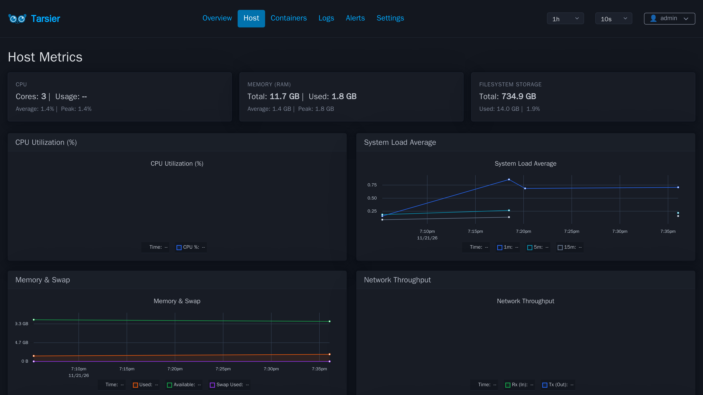
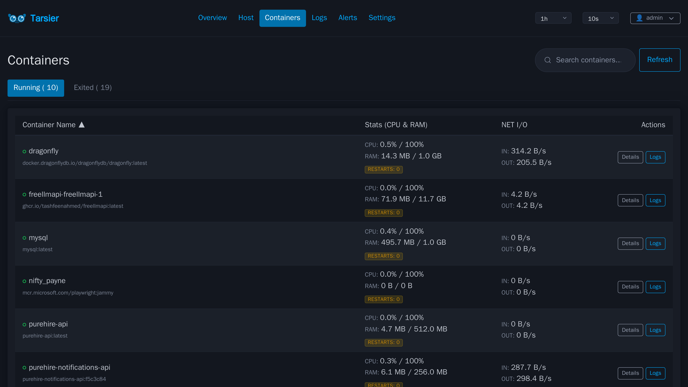
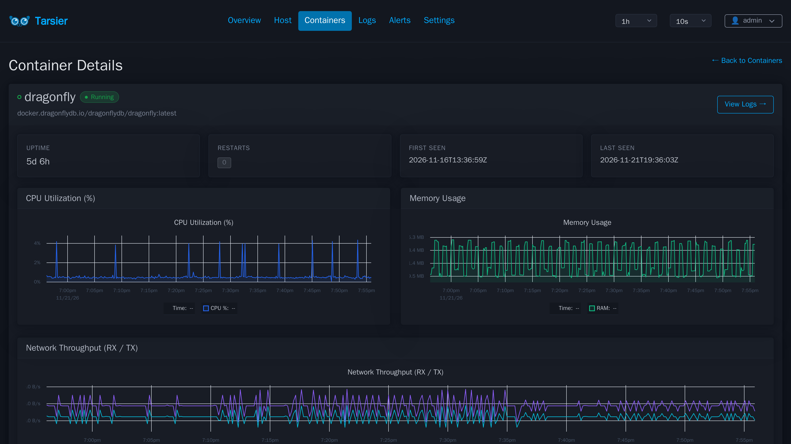

# 3. Host & Container Monitoring

Tarsier collects host telemetry and Docker container metrics without shelling out to CLI utilities (`top`, `df`, `docker stats`) or importing heavy SDK dependencies.

---

## 1. Host Telemetry (`#host`)

### Direct `procfs`, `sysfs`, and `statfs` Parsing

When running on Linux with `/proc`, `/sys`, and `/` mounted read-only into `/host/proc`, `/host/sys`, and `/host/root`, `internal/collector/host` reads kernel counters directly:

* **CPU Utilization & Core Count (`cpu.go`):** Reads aggregate `cpu` and per-core `cpuN` ticks from `/host/proc/stat`, computing utilization deltas across polling intervals (`host.interval`, default `10s`), alongside `1m`, `5m`, and `15m` load averages from `/host/proc/loadavg`.
* **Memory & Swap (`memory.go`):** Parses `/host/proc/meminfo` (`MemTotal`, `MemAvailable`, `MemFree`, `Cached`, `Buffers`, `SwapTotal`, `SwapFree`) to track used vs. available RAM and swap space.
* **Storage Discovery & Disk I/O (`disk.go`, `statfs_linux.go`):**
  * When `host.disks` is empty (`[]`), Tarsier inspects `/host/proc/self/mountinfo` (or `/host/proc/mounts`) and automatically discovers physical filesystems while excluding pseudo-filesystems listed in `host.disk_exclude_fs` (`tmpfs`, `overlay`, `squashfs`, `devtmpfs`).
  * Disk space is measured via native `syscall.Statfs` against `HOST_ROOT` mount paths.
  * Disk read/write throughput is computed from sector deltas in `/host/proc/diskstats`.
* **Network Throughput (`network.go`):** Parses `/host/proc/net/dev` for physical network interfaces (filtering virtual bridge/veth interfaces such as `veth*`, `docker*`, `br-*`, and `lo`) to compute inbound (`net_rx_bps`) and outbound (`net_tx_bps`) byte rates, packet rates, drops, and errors.

### Host Dashboard Layout

The `#host` dashboard presents a two-row KPI summary header (showing detected CPU cores and physical filesystem capacity), five synchronized `uPlot` panels (CPU Utilization, System Load Average, Memory & Swap, Network Throughput, Disk I/O Throughput & Disk Usage), and a 14-day daily rollup history table.

---

## 2. Multi-Tier Metric Downsampler (`metrics.db`)

To preserve fast queries over long time horizons without unbounded SQLite growth, `internal/metrics` routes incoming `10s` samples into an in-memory `HotCache` ring buffer for sub-millisecond dashboard reads while persisting to `metrics.db` via the single-writer queue:

| Table | Granularity | Columns | Default Retention | Purpose |
|---|---|---|---|---|
| `sample_raw` | `10s` | `(series_id, ts, v)` | `24h` | High-resolution live charts and alert evaluation |
| `sample_1m` | `1m` | `(series_id, ts, avg, min, max)` | `7d` | Multi-hour and multi-day inspection |
| `sample_5m` | `5m` | `(series_id, ts, avg, min, max)` | `30d` | Weekly trend analysis |
| `sample_1d` | `1d` | `(series_id, ts, avg, min, max)` | `90d` | Midnight UTC rollups powering the 14-day Average vs. Peak capacity table |

All four sample tables use `WITHOUT ROWID` clustered primary keys `(series_id, ts)` so range scans read contiguous B-tree pages with minimal memory overhead.

---

## 3. Docker Container Discovery & Lifecycle Monitoring (`#containers`)

### Thin Hand-Rolled Unix Socket Client

`internal/docker` implements a lightweight HTTP-over-Unix-socket client talking directly to `/var/run/docker.sock` without importing the official Docker Go SDK:

* **Discovery & Glob Filtering (`discovery.go`, `filter.go`):** Periodically lists containers and filters names using `docker.include` and `docker.exclude` glob patterns (default excludes `["tarsier"]`).
* **Resource Stats Streaming (`stats.go`):** Computes container CPU %, memory used vs. memory limit, and network RX/TX byte rates every `docker.stats_interval` (`10s`).
* **Lifecycle Event Streaming (`events.go`):** Subscribes to the Docker `/events` stream and persists `start`, `stop`, `die`, `oom`, `restart`, `pause`, and `unpause` transitions directly into the `container_event` table of `config.db`, incrementing `restart_count` and feeding the container alert evaluator in real time.
* **Exited Container Pruning (`retention.containers_exited`):** Containers that enter an `exited`, `dead`, or `destroyed` state and do not restart within `retention.containers_exited` (default `24h`) are automatically filtered out of `#containers` API responses and permanently pruned from `container` and `container_event` in `config.db` during startup discovery sync, hourly background watchdog ticks, and daily cleanup runs. Raw log chunks under `/data/logs/<source_id>/` remain governed independently by `retention.logs`.

### Containers List View

The `#containers` view provides **Running** and **Exited** tabs, live name/image search, sortable columns, and a streamlined 4-column layout:

1. **Container Name:** Hollow health indicator circle (`green` healthy, `red` unhealthy/restarting/exited, `grey` N/A) plus container name and image subtitle.
2. **Stats (CPU & RAM):** Live CPU % (`X.X% / 100%`), memory used vs. limit, and a yellow `Restarts: N` badge.
3. **NET I/O:** Live inbound (`IN`) and outbound (`OUT`) throughput rates.
4. **Actions:** Quick links to **Details** (`#container-detail?container=<name>`) and **Logs** (`#logs?container=<name>`).

---

## 4. Container Detail View (`#container-detail`)

Clicking **Details** on any container opens `#container-detail?container=<name>`, displaying live CPU/RAM/Network `uPlot` charts synchronized to the global time range selector (`1h`, `6h`, `24h`, `7d`, `30d`), a 14-day daily Average vs. Peak history table, and the persisted container lifecycle event audit log (`start`, `die`, `oom`, `restart`, `stop`).

