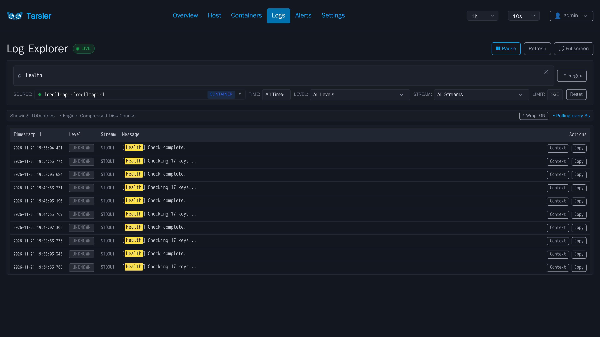
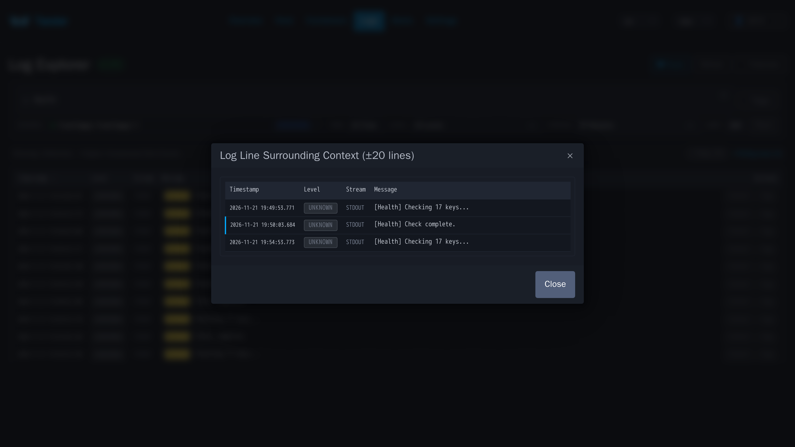
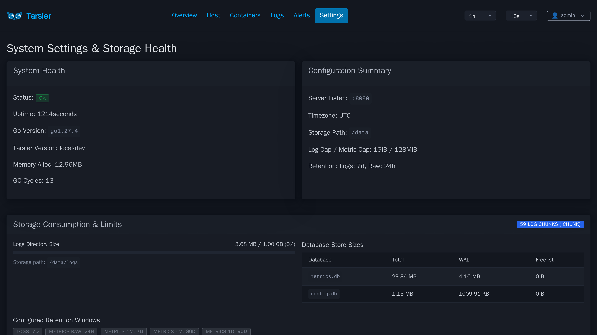
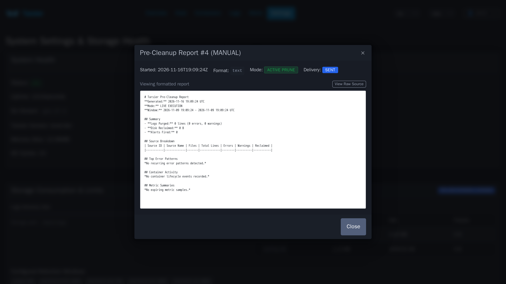

# 4. Log Search & Retention

Tarsier avoids storing logs in SQLite or FTS5 tables (`no logs.db`). Instead, logs are parsed in-place, buffered briefly in a bounded tail ring buffer, and written to immutable Zstandard-compressed chunk files with fixed-record sparse indexes.

---

## 1. Zero-Allocation Format & Level Detection (`< 10 µs` / line)

Every ingested log line (from Docker multiplexed `stdout`/`stderr` streams via `logs_demux.go` or host files tailed with inode rotation tracking via `internal/collector/file_tailer.go`) passes through `internal/logs` (`timestamp.go`, `level.go`):

* **In-Place `[]byte` Parsing:** Detection inspects up to `logs.detect.max_scan_bytes` (default `4096`, range `64..8192`) directly on `[]byte` without allocating `string` copies or compiling per-line regular expressions.
* **Supported Formats:** JSON structured logs, `logfmt` key-value lines, RFC 3164 / RFC 5424 Syslog, Apache/Nginx Common Log Format (CLF), and unstructured plain text.
* **Confidence Indicators (`logs.detect.hints: true`):**
  * **Timestamps:** Explicit parsed timestamps render cleanly; timestamps inferred from container/ingest time (`ts_src` `0` or `2`) render with a leading `~` indicator.
  * **Severity Levels:** Explicit level fields render as solid severity badges (`DEBUG`, `INFO`, `WARN`, `ERROR`, `FATAL`); levels inferred via zero-alloc keyword heuristics (`logs.detect.keyword_levels: true`, `level_src >= 3`) render with a dashed border badge (`badge-inferred`).

---

## 2. Chunk Storage Format (`64 KiB` Zstd + `.idx` Binary Search)

Logs are stored under `<storage.path>/logs/<source_id>/` using daily files:

* **Data Files (`<YYYY-MM-DD>.chunk`):** `ChunkWriterManager` accumulates per-source log records into a `64 KiB` (`65536` bytes) uncompressed block buffer prefixed with a 16-byte `TRLB` header (`BlockMagic = "TRLB"`, `BlockVersion = 0x01`), compresses each flushed block with `klauspost/compress/zstd` using `sync.Pool` buffers, and appends the Zstd frame to the `.chunk` file (flushed on size threshold or `1s` idle interval).
* **Sparse Index Files (`<YYYY-MM-DD>.idx`):** Each flushed block writes one fixed **36-byte** little-endian binary record (`IndexRecordSize = 36`) containing:
  * `MinTS` (`int64`, 8 bytes) & `MaxTS` (`int64`, 8 bytes)
  * `MinLevel` (`uint8`), `MaxLevel` (`uint8`), `StreamMask` (`uint8`), `Flags` (`uint8`)
  * `FileOffset` (`int64`, 8 bytes), `CompressedLen` (`uint32`, 4 bytes), `RecordCount` (`uint32`, 4 bytes)

---

## 3. Single-Source Query Engine & Boyer-Moore Search

All log queries in Tarsier are **scoped to a single source** (`source=<id>`). Keeping queries single-source avoids cross-container fan-out merges, bounds memory strictly during decompression, and guarantees predictable latency:

1. **Hot Tail Ring Buffer (`TailCache`):** Recent lines (up to `cache.log_tail_lines`, default `300` per source) are served directly from memory for instant live tailing.
2. **Sparse `.idx` Pruning:** For historical queries, `LogQueryEngine` binary-searches the 36-byte `.idx` records to skip blocks outside `[from, to]`, below `minLevel`, or outside the requested `stream` (`stdout`/`stderr`) mask.
3. **Zero-Alloc Byte Scanning:** Matching blocks are decompressed into pooled `sync.Pool` buffers and scanned with byte-level substring matching (Boyer-Moore / `bytes.Contains`) or compiled regex (`<= 512` bytes), using opaque keyset cursor pagination (`NextCursor`).

### Log Explorer (`#logs`)

The `#logs` explorer features a searchable source dropdown (with live/dead container status indicators), live `3s` tail polling with pause/resume, time-range presets and custom ranges, minimum severity filters, stream filters, regex toggle, line wrapping, and fullscreen mode.

### Surrounding Context Modal (`±20` Lines)

Clicking **Context** on any log line calls `GET /api/v1/logs/context?source=<id>&id=<record_id>&before=20&after=20`, reading the surrounding `±20` lines directly from the `TailCache` or decompressed `.chunk` block with the target line highlighted.

---

## 4. Retention, Compaction & Pre-Cleanup Digest Reports (`#settings`)

The `#settings` view exposes physical storage breakdown bars, active retention horizons, hot config reload, and the cleanup audit history.

### Hybrid Retention Executor (`internal/cleanup`)

Triggered on `cleanup.schedule` (default `"0 3 * * *"` daily at 03:00 UTC) or manually from `#settings`:

1. **Instant $O(1)$ Log Unlinks:** Expired `<YYYY-MM-DD>.chunk` and `.idx` files older than `retention.logs` are unlinked directly from disk without rewriting databases.
2. **Emergency Disk-Cap Eviction:** If `/data/logs/` exceeds `storage.logs_max_size`, the oldest chunk/index pairs are purged down to `90%` of the configured limit (10% hysteresis).
3. **Chunked `metrics.db` Pruning:** Expired rows in `sample_raw`, `sample_1m`, `sample_5m`, and `sample_1d` (plus `container_event` and `alert_event` in `config.db`) are deleted in bounded batches (`cleanup.batch_size`, default `5000` rows) separated by `cleanup.batch_pause` (`50ms`) so the single-writer queue never blocks live metric ingestion.
4. **Automated SQLite Maintenance (`maintenance.go`):** After pruning, `DatabaseMaintainer` runs bounded `PRAGMA incremental_vacuum(pages)` passes (default `2000` pages per pass, up to `16` passes with `25ms` pauses), `PRAGMA optimize`, and `PRAGMA wal_checkpoint(TRUNCATE)`.

### Pre-Cleanup Digest Reports & Dry-Run Mode

Before deleting expired records, `NormalizeMessage` (`normalizer.go`) replaces dynamic values (`{ts}`, `{uuid}`, `{ip}`, `{str}`, `{hex}`, `{path}`, `{num}`) to group recurring error patterns in a memory-bounded counter, generating a plain-text or HTML digest report (`cleanup.report.format`) with purged volumes, top normalized error patterns, container lifecycle summaries, and host metric peaks.

* **Delivery Gating:** Retries delivery across `cleanup.report.channels` (`min_attempts` / `retry_delay`). Setting `on_failure: "block"` aborts deletion if report delivery fails, preserving the unpurged audit trail; `"proceed"` logs the warning and continues cleanup.
* **Dry-Run & Custom Template Preview:** Trigger a non-destructive **Run Dry-Run** or test custom Go `text/template` layouts from `#settings`. Stored reports render safely inside sandboxed `<iframe>` tags (`sandbox="" :srcdoc="..."`).

