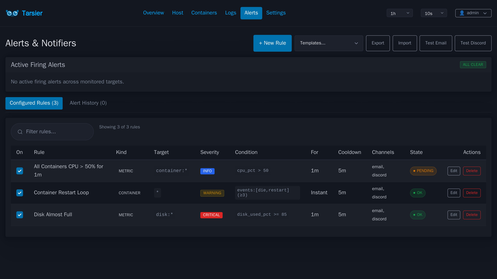
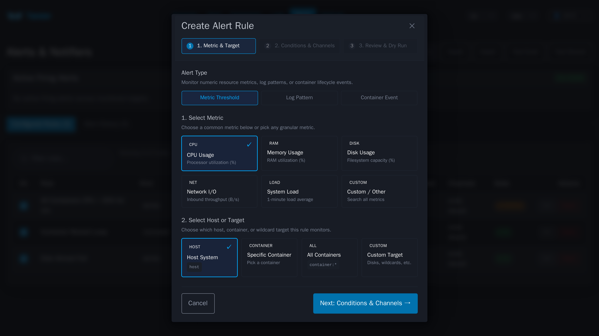

# 5. Alerting & Notifications

Tarsier evaluates metric thresholds, streaming log patterns, and container lifecycle events completely in memory against live telemetry, persisting rules, active states, and historical alert events in `config.db`.

---

## 1. Why Alert Rules Live in `config.db` (Not `tarsier.yaml`)

Infrastructure topology (`server`, `storage`, `retention`, `notifiers`) belongs in `tarsier.yaml` so deployments remain declarative and reproducible. Alert rules, however, are operational state:

* Operators create, edit, silence, enable/disable, and dry-run alert rules interactively in `#alerts` without restarting or editing YAML on disk.
* Storing rules in `config.db` (`alert_rule`, `alert_rule_state`, `alert_event`) enables atomic updates, instant `RuleCache` swap callbacks, and JSON export/import portability across servers.
* Remember: adding an `alerts:` section to `tarsier.yaml` will fail startup due to strict `KnownFields(true)` validation.

---

## 2. Three Alert Rule Kinds

### Metric Threshold Rules (`kind: "metric"`)

Evaluates numerical comparisons (`>`, `>=`, `<`, `<=`, `==`) over host or container metrics:

* **Targets:** `"host"`, `"disk:*"` (or specific mount), `"container:*"` (all containers), or `"container:<name>"`.
* **Built-in Metrics:** `cpu_pct`, `mem_used_pct` (host), `mem_pct` / `mem_used` (container), `disk_used_pct`, `net_rx_bps`, `net_tx_bps`, `load_1m`, `load_5m`.

### Log Pattern Rules (`kind: "log"`)

Evaluates ingested log lines in real time inside `internal/alert/evaluator_log.go`:

* Supports zero-alloc substring byte matching (`ByteNeedle`) or pre-compiled regular expressions (`<= 512` bytes), optional case-insensitivity, and a minimum severity filter (`min_level`).
* Triggers when matching occurrences reach `threshold` (`1..10000`) within a sliding time window (`window_sec`, `10..86400` seconds).

### Container Lifecycle Rules (`kind: "container"`)

Subscribes directly to Docker lifecycle events (`evaluator_container.go`):

* Watches any subset of `["oom", "die", "restart", "stop", "down"]`.
* Supports immediate single-event triggers (`window_sec: 0`, `threshold: 1` for OOM kills) or restart-loop detection (e.g. `>= 3` `die`/`restart` events within `300s`).

---

## 3. Evaluation State Machine

`internal/alert/statemachine.go` manages per-`(rule_id, target)` transitions (`OK`, `PENDING`, `FIRING`, `RESOLVED`):

1. **OK -> PENDING:** When a condition evaluates true and `for_sec > 0`, the target enters `PENDING` and records `since`. If the condition clears before `for_sec` elapses, it resets cleanly to `OK` (hysteresis against transient spikes).
2. **PENDING -> FIRING:** Once the condition remains continuously true for `for_sec` seconds (or immediately when `for_sec == 0`), the state transitions to `FIRING`, persists an `alert_event` row in `config.db`, and dispatches notifications.
3. **Cooldown Suppression:** While `FIRING`, repeat notifications are suppressed until `cooldown_sec` (`0..604800`, default `300s`) elapses, unless severity escalates.
4. **FIRING -> OK (Recovery):** When the condition clears, the active `alert_event` is marked `resolved` and, if `notify_recovery` is enabled on the rule, a resolution notification is dispatched.

---

## 4. Alerts Dashboard & Guided Rule Builder (`#alerts`)

The `#alerts` view displays currently firing alerts, configured rules with live state pills (`OK`, `PENDING`, `FIRING`), built-in rule templates, JSON export/import, and one-click **Test Email** / **Test Discord** buttons.



Clicking **+ New Rule** launches the 3-step guided Rule Builder wizard (**1. Metric & Target**, **2. Conditions & Channels**, **3. Review & Dry Run**), which previews rule evaluations live against real telemetry via `POST /api/v1/alerts/rules/preview` before saving.



---

## 5. Notification Channels & Outgoing Heartbeat

### Discord Webhooks

Configure `notifiers.discord` in `tarsier.yaml` and inject the secret URL via `DISCORD_WEBHOOK_URL`:

```yaml
notifiers:
  discord:
    enabled: true
    webhook_url: "${DISCORD_WEBHOOK_URL}"
    mention: "@here"
```

Tarsier sends severity color-coded Discord embeds containing target, rule condition, live summary, and a link back to `server.base_url`.

### SMTP Email

Configure `notifiers.email` with `security: "starttls"` (port `587`), `"tls"` (port `465`), or `"none"` (port `25`):

```yaml
notifiers:
  email:
    enabled: ${SMTP_ENABLED:-false}
    smtp_host: "${SMTP_HOST}"
    smtp_port: ${SMTP_PORT:-587}
    security: "${SMTP_SECURITY:-starttls}"
    username: "${SMTP_USER}"
    password: "${SMTP_PASSWORD}"
    from: "${SMTP_FROM}"
    to: ["${SMTP_TO}"]
```

### Outgoing Heartbeat Ping

To detect if the monitoring server itself goes offline, enable `heartbeat` in `tarsier.yaml` to send periodic HTTP GET pings (with Tarsier version metadata in `User-Agent`) to dead-man-switch services like Healthchecks.io, Uptime Kuma, or Better Uptime:

```yaml
heartbeat:
  enabled: true
  url: "${HEARTBEAT_URL}"
  interval: "5m"
  timeout: "10s"
```
