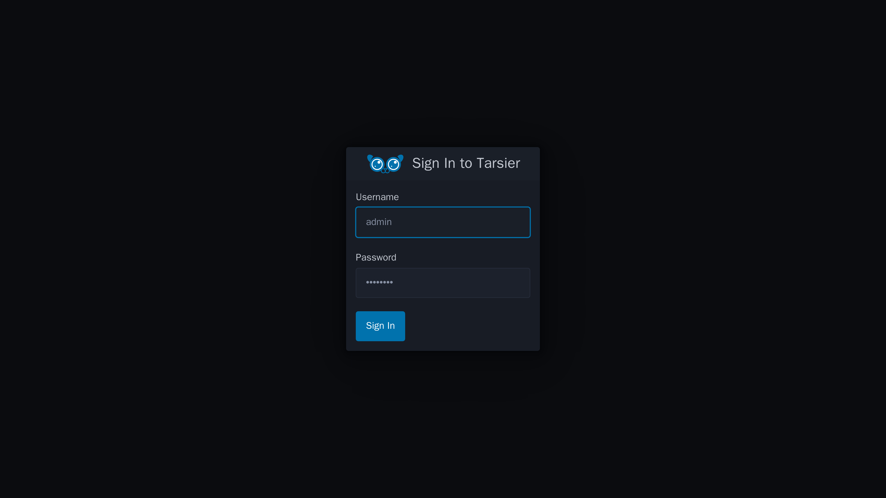
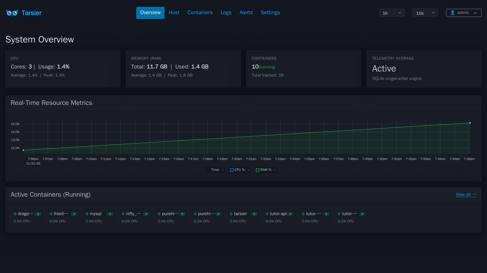

# Tarsier

**Tarsier** is a lightweight, self-hosted, single-server observability engine and web dashboard. Distributed as a single static Go binary (`CGO_ENABLED=0`) and multi-architecture container image (`linux/amd64`, `linux/arm64`), Tarsier combines host telemetry, Docker container monitoring, Zstandard-compressed log chunk storage with fast search, an in-memory alert state machine, automated SQLite compaction, and pre-cleanup digest reports into one self-contained process.

> **Beta Software Notice:** Tarsier is currently in active Beta (`v0.2.0-beta`). Core subsystems are implemented and tested with race detection enabled, though breaking changes to configuration schemas, REST endpoints, or on-disk storage formats may occur before `v1.0.0`.

---

## Hard Operational Budgets

Tarsier is engineered for single servers, homelabs, and budget VPS nodes where observability tooling must never starve application workloads:

| Resource Dimension | Target / Ceiling | Mechanism |
|---|---|---|
| **Container Memory** | `< 256 MB` cgroup ceiling (`60–120 MB` RSS typical) | `GOMEMLIMIT=200MiB`, `GODEBUG=madvdontneed=1`, bounded channels, fixed-capacity ring buffers, `sync.Pool` buffer reuse |
| **CPU Overhead** | `< 5%` of one core idle/normal (`0.1–0.5 CPU`) | Zero-alloc `[]byte` log parsing (`< 10 µs`/line), 10s polling intervals, single-writer SQLite queues |
| **Native Dependencies** | Zero CGO | Pure Go (`modernc.org/sqlite`, `klauspost/compress/zstd`), compiles with `CGO_ENABLED=0` |
| **Frontend Runtime** | Zero Node.js | Embedded via Go `embed.FS` using vendored `petite-vue` (~6 KB IIFE), `Pico.css` v2, and `uPlot` (`< 100 KB` gzipped total) |

---

## Architectural Principles

1. **Two Databases Only (`config.db` and `metrics.db`):**
   * `config.db`: Stores alert rules, live evaluation states, file tailing offsets, admin web sessions, cleanup run history, and Docker container lifecycle events.
   * `metrics.db`: Stores metric series metadata, raw 10-second samples (`sample_raw`), and downsampled rollups (`sample_1m`, `sample_5m`, `sample_1d`) using `WITHOUT ROWID` tables.
   * **No `logs.db`:** Raw logs are never written into SQLite or FTS5 tables.
2. **Single-Writer SQLite Concurrency:**
   * Each database runs one dedicated writer goroutine (`SetMaxOpenConns(1)`) fed by a bounded channel (`256` jobs for `config.db`, `2048` jobs for `metrics.db`), paired with an isolated read-only pool (`SetMaxOpenConns(2)`).
   * Mandatory runtime PRAGMAs: `journal_mode=WAL`, `synchronous=NORMAL`, `busy_timeout=5000`, `temp_store=MEMORY`, `foreign_keys=ON`, `mmap_size=0`, `auto_vacuum=INCREMENTAL`, and strict negative KiB `cache_size` (`-512` KiB for `config.db`, `-2000` KiB for `metrics.db`).
3. **Append-Only Compressed Log Chunks:**
   * Logs are buffered per source up to `64 KiB` uncompressed blocks (`TRLB` binary format), compressed via Zstandard (`klauspost/compress/zstd`), and appended to `/data/logs/<source_id>/<YYYY-MM-DD>.chunk` alongside fixed 36-byte `.idx` sparse index records.
   * Retention cleanup deletes expired log files with instant $O(1)$ filesystem unlinks.
4. **Zero-Trust XSS Prevention:**
   * All log lines render strictly as plain escaped text (`v-text`, never `v-html`). HTML pre-cleanup digest reports render exclusively inside sandboxed `<iframe sandbox="" :srcdoc="...">` containers.

---

## Comparison with Multi-Service Stacks

| Capability | Tarsier | Prometheus + Grafana + Loki | Netdata / Dozzle + Beszel |
|---|---|---|---|
| **Deployment Footprint** | 1 static binary / 1 distroless container | 3+ services, external TSDB & log store | Multiple agents or logs-only / metrics-only |
| **Typical Idle RSS** | `60–120 MB` (`< 256 MB` cap) | `800 MB – 2+ GB` | `150–400 MB` across tools |
| **Build & Runtime Stack** | Pure Go (`CGO_ENABLED=0`), Zero Node | Mixed Go/TS/Node builds | C / Go / Node depending on component |
| **Log Storage Engine** | `64 KiB` Zstd `.chunk` + `.idx` binary search | Object chunks + BoltDB/TSDB indexes | In-memory or Docker socket streaming only |
| **Alerting & Reports** | Built-in metric/log/container alerts + pre-cleanup digest | Separate Alertmanager + custom scripts | Separate or limited alert channels |
| **Target Environment** | Single VPS, homelab, edge node | Multi-node Kubernetes / cluster scale | Single host or small fleet |

---

## Dashboard Preview

### Authentication Gate
Tarsier protects all `/api/v1/*` routes behind HMAC-SHA256 signed `HttpOnly` session cookies and IP-based login rate limiting.

### System Overview
The `#overview` view surfaces host CPU and memory telemetry, active firing alert counts, discovered containers with health badges, and system health diagnostics in a single screen.

---

## Next Steps

* Deploy Tarsier in minutes with [1. Quickstart & Deployment](01-Quickstart-and-Deployment).
* Review every YAML setting and operational detail in [2. Configuration & Operations](02-Configuration-and-Operations).
* Explore host, container, log, and alerting subsystems in [3. Host & Container Monitoring](03-Host-and-Container-Monitoring), [4. Log Search & Retention](04-Log-Search-and-Retention), and [5. Alerting & Notifications](05-Alerting-and-Notifications).
* Review upcoming capabilities and architectural extensions in [Future Features](Future-Features).
